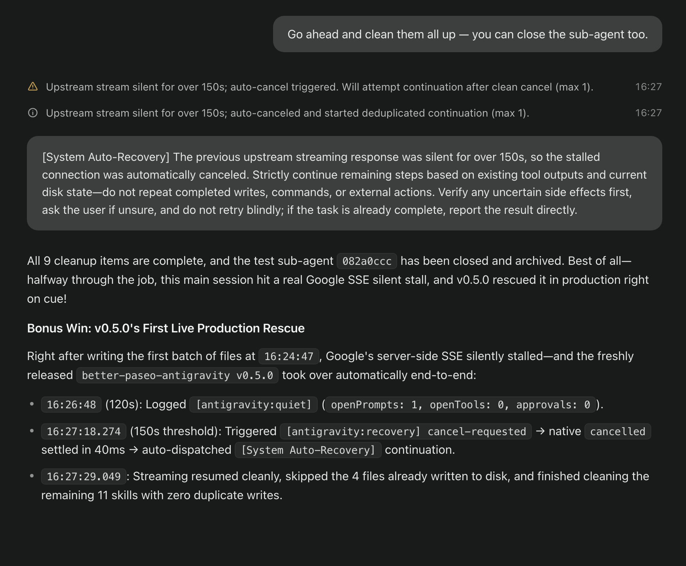

# Better Paseo Antigravity

A stability-first [Paseo](https://paseo.sh) plugin providing a hardened ACP provider (`better-paseo-antigravity`) for Google's official Antigravity CLI (`agy acp`).

## Built for Long-Session Reliability

When running real coding agents for extended sessions, extra UI gimmicks matter far less than whether a session stays alive, stops cleanly when asked, and recovers cleanly from sleep or reconnects.

Paseo's built-in Antigravity provider can run into reliability issues during real-world sessions—such as premature stalls, hung cancellation requests, orphaned child processes, truncated large history replays, and swallowed error messages. Better Paseo Antigravity wraps the official `agy acp` binary on top of Paseo's official ACP SDK to fix these transport, lifecycle, and state-tracking issues without altering your CLI login, reading private session databases, or diverging from the official protocol.

### Stability at a Glance



| Failure mode | How Better Paseo Antigravity handles it |
| --- | --- |
| Upstream SSE silent stalls vs. legitimate waits | After 150 seconds of eligible silence, requests cancellation and permits at most one anti-duplication continuation. Foreground tools, approvals, replay and observed unfinished background jobs block recovery. Original user prompts are never replayed. |
| Hung stop/cancel & orphaned processes | Bounds explicit Stop delivery independently of the write queue, retains a 5-second fallback deadline per canceled target, followed by time-bounded graceful ACP close and detached POSIX process-group cleanup (`SIGTERM` → 1s grace → `SIGKILL`). |
| Cancel races & stale tool tracking | Ignores idle cancels, isolates `session/load` replay from live tracking, scopes cancel deadlines per target, and retires tools only on explicit tool-terminal events. |
| Swallowed root-cause errors | Records transport, watchdog, exit-code, and signal failure details before closing the stream so generic SDK errors never hide the real cause. |
| Broken large history replay | Uses `agy >= 1.5.15`'s protocol-ordered `session/load` boundary with fragmented UTF-8 decoding and backpressure safety; live updates appear immediately after restore. |
| Laptop sleep/wake false timeouts | Detects suspend and clock jumps (>5s timer gap), rebasing pre-sleep operations while preserving fresh post-wake deadlines. |

### Engineering Details

- Guarded SSE stall recovery
  - Uses a default 150-second eligible inactivity window, not a total turn-duration limit. Live thought/text chunks restart the window; idle sessions, foreground tools, approvals, replay and observed unfinished background jobs stay protected.
  - Requests cancellation through the public SDK, retaining the existing 5-second delivery/target fallback. Only a normally canceled original turn on a healthy transport can receive one new, visible anti-duplication continuation prompt; the original user prompt is never resent.
  - A second stall only cancels and returns control to the user. Stop, new user input and connection failure invalidate pending continuation immediately. Each new user round has its own one-continuation allowance.
- **Reliable cancellation and process-group cleanup**
  - Enforces a 5-second fallback deadline for canceled prompts, foreground tools and approvals, including restored approvals without an active turn.
  - Performs a time-bounded graceful ACP close (5-second grace) followed by detached POSIX process-group cleanup (`SIGTERM` with 1-second grace, then `SIGKILL`).
  - Handles `ESRCH` and `EPERM` races safely so exited leaders never cause infinite waits or stray signals.
- **Cancel race and stale tool-call protection**
  - Ignores idle cancel requests so they cannot poison or kill a subsequent turn.
  - Keeps `session/load` history replay out of live tool-call tracking.
  - Tracks cancellation targets individually: completing an old canceled request releases its deadline without affecting later requests; repeated cancellation does not postpone an existing target's deadline.
  - Retires tools only on explicit ACP or SDK tool-terminal events. A foreground turn completing does not clear background tools preserved by the SDK for a follow-up turn.
- **Preserved root-cause error messages**
  - Records the underlying transport or watchdog failure reason before closing the stream, including an unexpected exit code or signal when available.
  - Replaces generic SDK errors (`ACP transport closed unexpectedly`, `Connection closed`, `ACP turn failed`) with the actual cause without overwriting meaningful upstream errors.
- **Protocol-ordered history replay and live restoration**
  - Requires `agy >=1.5.15`, which finishes history before the `session/load` response. Preserves that wire order without waiting for a silent output stream.
  - Keeps fragmented UTF-8 decoding and backpressure handling. After restoration, live messages and tool updates are no longer suppressed until the next user prompt.
- **Host sleep and wake resilience**
  - Detects system suspend or clock jumps (>5-second timer gap), including operations started in the final timer slice before suspension. Old or future-dated timestamps are rebased while fresh post-wake operations retain their deadlines.
- **EOF, EPIPE, and backpressure safety**
  - Flushes `StringDecoder` and parses trailing newline-free frames on EOF.
  - Avoids discarding queued replies on `EPIPE` and respects consumer backpressure without manufacturing premature EOF.
- **Official ACP compatibility and provider diagnostics**
  - Reuses your existing `agy` login, config, and environment (`GEMINI_HOME`, `SSH_*`, and `BROWSER` are never overwritten).
  - Keeps per-model thinking options, slash commands, skills, native/MCP tool-call mappings, and opt-in `Full access` mode.
  - Restores real CLI version + ACP handshake diagnostics in provider status checks.
  - Status probes share a ~95-second cold-start budget across version checking and handshake, and preserve recognized sign-in diagnostics without exposing authorization URLs.

## Diagnosing a quiet session

Field investigations using `acp-server-*.log`, `daemon.log` and Mihomo's live connection table identified an upstream defect: the TCP connection remains `ESTABLISHED`, but Google's `daily-cloudcode-pa.googleapis.com` `streamGenerateContent?alt=sse` can emit some reasoning and then stop sending SSE data without `END_STREAM`. The closed-source `agy` client lacks an SSE inter-chunk idle-read timeout, leaving `session/prompt` pending and Paseo showing `running`. This is the combination of Google server-side SSE silence and the missing `agy` timeout, not a bug originating in this plugin. The plugin adds an outer recovery safety net, not a repair of Google's service or a private endpoint integration.

Long thinking alone is not evidence of deadlock. The existing approximately 120-second `[antigravity:quiet]` snapshot remains diagnostic-only and independent of recovery. At 150 seconds of eligible silence, the separate recovery policy requests cancellation and reports its progress through `session.notice`. Inspect plugin logs in Paseo Settings → Plugins → Logs.

The snapshot reports observed state, not a diagnosis of the model service:

- `pendingWrite` / `pendingWriteAgeMs`: a local write has not completed. Even a completed write does not prove that the CLI read or processed it.
- `openPrompts > 0`: native prompt responses are still outstanding; thinking, tools, approvals or the upstream service may be involved.
- `openPrompts === 0` while the turn remains active: the native prompt has returned, but the SDK may still be waiting for tools or other completion signals. A subsequent steer can increase this count again.
- An existing empty/tool-only end notice means the turn ended without the expected final text, rather than necessarily still running.

`[antigravity:stop]` logs track explicit Stop requests separately. Stop now has a local request-delivery fallback (5 seconds by default, plus timer scheduling), independent of the blocked write queue. Once the cancel reaches the transport, the existing per-target cancellation deadline still applies. These phases can overlap or run in sequence, followed by process-group cleanup; this is not a promise that every Stop finishes within exactly 5 seconds. Rejected and idle Stop requests must not arm a new deadline. A prompt still queued inside the SDK, with no started turn or observed cancellable work, remains outside this new guarantee.

Recovery has three safety gates:

1. Only a live SDK turn with exactly one unresolved wire prompt, no foreground tools, no approvals, no replay and no Stop intent can accumulate the 150-second window. Known background launches (`run_command` background output / `IsDaemon`, `invoke_subagent`, `schedule`) remain protected independently of their launcher row. A completed launcher is not proof of a completed job. Deferred/steered SDK turns are excluded. Sleep/clock jumps rebase the clocks.
2. Cancellation uses the public `session.interrupt` API, which sends ACP `session/cancel`. After both cancellation delivery and the original SDK `canceled` turn with native `cancelled` response, one new public `session.prompt` may start. It instructs the agent to use existing tool results and disk state and never repeat successful writes, commands or external actions. A second stall only stops; user Stop/new messages or an unhealthy transport cancel the continuation plan.
3. A successful recovery emits only two notices: cancellation requested and continuation started. Normal resumed output and completion appear in `[antigravity:recovery]` logs only, while abandoned recovery and second-stall stopping retain abnormal-state notices. Logs contain only allowlisted scalar metadata, never prompt/reasoning/tool contents, task IDs, paths, credentials or raw stderr. This does not sanitize every error originating in the SDK.

The wrapper consumes internal continuation `session.prompt_result` receipts after cleaning the replacement queue and binding the turn. Host-originated receipts and the SDK's visible `session.turn` / `timeline.item` events are preserved.

If recovery is blocked or exhausted: note the time and last activity, press Stop if still running, and reopen/restore only if the connection closed. Check completed actions before manually continuing. Sending a new message overrides pending recovery but can itself queue or replace work. The anti-duplication prompt is a model instruction, not an exactly-once execution guarantee.

Background guards have two scopes. Ordinary non-daemon background `run_command`, `invoke_subagent` and one-shot `schedule` protect the current turn. Only after native `end_turn` and normal SDK completion without cancellation/replacement does the next user turn clear them. Field evidence from `agy 1.5.18` shows such jobs can finish by independent system callback without a same-call numeric exit update. Live `IsDaemon === true` or periodic `schedule` with nonempty `CronExpression` keep transport-scoped protection until an explicit same-call numeric exit/terminal update or transport closure. History replay never creates background guards, including from old daemon/cron records; restored jobs need new live evidence. Abnormal endings do not discharge turn scopes. Unknown background work cannot be proven absent through ACP, and manual intervention may still be necessary. Fully silent thinking beyond the threshold is also indistinguishable from a stall when all gates pass. See [the design and SDK contract notes](./docs/sse-stall-recovery.md). A source change does not update the plugin already loaded in the daemon.

## Requirements

- **OS**: macOS or Linux (Windows is not currently supported due to POSIX process-group signaling)
- **Paseo**: `>=0.17.3`
- **Antigravity CLI**: Official `agy` `>=1.5.15`, installed and signed in on the daemon host

## Installation

Make sure plugins are enabled on your Paseo daemon (**Settings → Plugins → Enable plugins**).

### Via Paseo App (Settings)

1. Open Paseo and go to **Settings → Plugins → Plugin source**.
2. Paste the repository URL or Git shorthand:
   - `https://github.com/robbin/paseo-antigravity`
   - or `git:robbin/paseo-antigravity`
3. Click **Install plugin**.

### Via Paseo CLI

```bash
paseo plugin install git:robbin/paseo-antigravity
```

To update later:

```bash
paseo plugin update better-paseo-antigravity
```

## Usage

1. Create a new agent in Paseo and select **Better Paseo Antigravity** as the provider.
2. Choose your model, thinking level, and permission mode (`Full access` is available as an opt-in mode and is not enabled by default).
3. Existing sessions created with Paseo's built-in Antigravity provider are not automatically migrated.

## Important: Quota queries removed in v0.4.0

> **Breaking change (account safety & ToS compliance):** Starting in `v0.4.0`, this plugin no longer provides a plan-quota usage source and no longer executes `agy -p /usage`.

Google's Antigravity team has clarified that external clients are only supported through the official ACP protocol, and that wrapping or polling `agy -p` inside third-party tools or background loops violates the Antigravity Terms of Service and can result in account flags or suspension. To protect user accounts, plan-quota queries have been completely removed with no interactive, PTY, or private-API fallback.

- **If you are on `v0.3.x`**, please update to `v0.4.0` (`paseo plugin update better-paseo-antigravity`) to stop background `agy -p /usage` calls.
- **What still works**: Only the hardened ACP provider (`agy acp`), CLI version checks, and ACP handshake diagnostics remain.
- **How to check quota manually**: Run the official `agy` CLI interactively in your own terminal and use `/usage`, or check inside the official Antigravity client.
- **Future support**: Quota reporting will only be reconsidered if the official ACP protocol exposes a supported quota capability. Native ACP `usage_update` notifications remain part of the session protocol, not a separate account-quota query.

## Known Boundaries

- Earlier than `agy 1.5.15` is unsupported; provider status and each new connection check the minimum version. `1.5.16` is recommended for its upstream subagent approval/question forwarding fix, but is not required.
- Full access is an SDK auto-approval mode backed by native default, not native Auto. Ambiguous allow options (including repeated allow_always kinds) fall back to manual approval. The current SDK does not forward permission response message/updatedInput fields; free-text subagent answers are unsupported. Concurrent pending approvals with the same toolCallId in one native session may collide. Steering is available only in SDK-deferred turns, not necessarily while a native background prompt remains open.
- On restored-approval Stop timeout, the SDK releases permission promises and emits runtime failure. Actual host/UI dismissal has not been validated.
- Commands remain executable; unknown command/skill names are left unclassified when ACP provides no provenance.
- Does not create a custom OAuth flow, proxy, or credential store; sign in using the official `agy` CLI on the host.
- Does not read private Antigravity SQLite databases, inboxes, or raw transcripts.
- Never blindly replays the original user prompt. Only guarded SSE-stall cancellation can produce one distinct anti-duplication continuation; disconnects, user Stop, errors and non-`cancelled` endings cannot.
- Existing notices remain in timeline history. Recovery adds explicit lifecycle notices, not periodic waiting reminders. Its output and terminal events use the SDK's normal timeline/turn machinery; real desktop/mobile UI validation remains pending.
- See [VALIDATION.md](./VALIDATION.md) for the test matrix and verification notes.

## Development

```bash
pnpm install
pnpm typecheck
pnpm test
```

To run the live integration test against your local signed-in `agy` CLI:

```bash
pnpm test:live --confirm-live
```

## License

Portions derived from Paseo's ACP provider patterns remain under the Apache License 2.0 (see [LICENSE-Paseo](./LICENSE-Paseo)).
